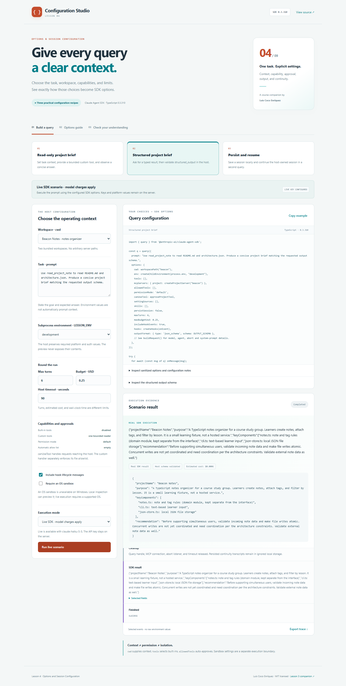

# Lesson 04 · Configuration Studio

A student companion to **Claude Agent SDK TypeScript version 0.3.310**, by Luis Coco Enríquez.

Learn **Lesson 4: Options and Session Configuration** by choosing a task, workspace, environment, capabilities, approvals, output format, limits, and session behavior. The application turns those choices into a server-validated query preview and can execute the configuration through the real SDK.



## Run locally

Requirements: **Node.js 22.14+**, npm, Git, and a browser.

```sh
git clone https://github.com/luiscoco/claude-agent-sdk-lesson-04.git
cd claude-agent-sdk-lesson-04
npm ci
npm run dev
```

Open **http://127.0.0.1:4341**. Local inspection works without an API key.

1. Choose a recipe and either the **Atlas Tasks** or **Beacon Notes** fixture workspace.
2. Adjust the prompt, environment label, limits, and hook-event setting.
3. Inspect the generated TypeScript, sanitized options, and configuration notes.
4. Click **Inspect locally** to call a real SDK-hosted MCP tool without a model request.
5. With your own server-side key configured, select **Live SDK** to execute the prompt.

The [classroom walkthrough](docs/lesson-4-walkthrough.md) includes exercises and answers.

## Three recipes

| Recipe                   | What students learn                                                        | Actual live behavior                                                                                           |
| ------------------------ | -------------------------------------------------------------------------- | -------------------------------------------------------------------------------------------------------------- |
| Read-only project brief  | Separate task/context, environment, capabilities, and permission decisions | The SDK uses a bounded MCP reader and returns an answer grounded in the selected workspace.                    |
| Structured project brief | Request a JSON-schema result and validate it in the host                   | The SDK receives `outputFormat`; the host validates `structured_output` with Zod.                              |
| Persist and resume       | Distinguish new identity, saved history, and continuation                  | A new query saves a transcript; a subsequent query uses `resume` with this host's saved ID for that workspace. |

**Local inspection** is an actual in-memory MCP initialize/call round trip against the selected fixture. The host selects the tool directly. It does not execute the user prompt, generate an AI answer, exercise permissions/hooks, validate model output, resume a session, or establish an OS sandbox. Those behaviors require live execution. The UI and exported result distinguish the two modes.

## Configure live scenarios

Copy `.env.example` to `.env`, set **your own** `ANTHROPIC_API_KEY`, and restart the server. In PowerShell:

```powershell
Copy-Item .env.example .env
```

Optionally set `ANTHROPIC_MODEL` to a model available to your account. The key is read only by the Node.js host; `.env` and `.local` are ignored by Git. Keys and platform environment values are never included in the preview, generated example, or browser metadata.

Choose **Live SDK · model charges apply** and run a scenario. Use **Stop this run** to abort the request and query. Failed live requests are reported explicitly; the application never substitutes a local inspection result.

Real model runs were manually verified for all three recipes, including a second resumed query. See [live verification](docs/live-verification.md). The automated suite and GitHub Actions do not require credentials or make model requests.

## Lesson concepts mapped to implementation

| Concept                         | This sample                                                                                                                                                                                                                      |
| ------------------------------- | -------------------------------------------------------------------------------------------------------------------------------------------------------------------------------------------------------------------------------- |
| `prompt`                        | A top-level task with an observable output goal.                                                                                                                                                                                 |
| `options.cwd`                   | One of two bundled fixture workspaces. It selects context, not filesystem isolation.                                                                                                                                             |
| `options.env`                   | A filtered child environment with necessary platform/auth values and the selected `LESSON_ENV`. An explicit env replaces inheritance. It does not put variables into the prompt automatically.                                   |
| `tools` and `mcpServers`        | Built-in tools are disabled. One SDK-hosted reader exposes only `README.md` and `architecture.json`.                                                                                                                             |
| `allowedTools` and `canUseTool` | The automatic allow list is empty. Requests that reach the host are checked for the exact registered SDK tool, provenance, and valid note name. The tool handler independently enforces its allowlist and real-path containment. |
| `permissionMode`                | `default`, with a narrow host approval callback. No bypass mode is offered.                                                                                                                                                      |
| `hooks` and `includeHookEvents` | Pre/post-tool callbacks log selected events. The checkbox separately controls hook lifecycle messages in the SDK stream.                                                                                                         |
| `agents` and `skills`           | A context-reviewer agent is configured as an example, but not launched; built-in Agent is unavailable. The skill filter is explicitly empty.                                                                                     |
| `outputFormat`                  | The structured recipe requests a JSON schema and validates the result in the host.                                                                                                                                               |
| Run limits                      | `maxTurns`, `maxBudgetUsd`, and a separate host wall-clock abort timer. Budget values are SDK estimated-cost limits.                                                                                                             |
| Persistence                     | Ephemeral recipes set `persistSession: false`. Continuity uses a new UUID and persistence, then `resume` for later queries.                                                                                                      |
| Sandbox                         | Tools-only mode makes no OS-isolation claim. Requiring an OS sandbox sets `enabled: true, failIfUnavailable: true`; Windows live execution is rejected, and other platforms still need supported dependencies.                   |

See [buildRequest()](src/server/runner.ts) for the complete, type-checked request. The generated UI example uses named host helpers and placeholders; it is an explanatory fragment, not a standalone script. Those helpers live in this repository.

## Version corrections to conceptual lesson examples

This sample follows the pinned **0.3.310** declarations:

- The call shape is `query({ prompt, options: { cwd, env, maxTurns, ... } })`; runtime options are nested.
- Structured output uses `options.outputFormat: { type: 'json_schema', schema }`, not a top-level `outputSchema`.
- `tools` restricts built-in availability. `allowedTools` auto-approves names; it is not a tool allowlist for availability.
- `canUseTool` handles permission requests that reach the host. Do not rely on it being called for every tool invocation or auto-approved action.
- `initializeTimeoutMs` belongs to `startup()` / `prewarm()` preparation in this version, not ordinary `query` options. The host timeout in this app is separate.
- `sessionStore` is an **alpha transcript mirror** requiring local persistence; it cannot be combined with `persistSession: false`.

The [preparation examples](src/examples/preparation.ts) are compile-checked and deliberately not executed by the UI. When using `startup()`, close unused handles. The ordinary recipes begin with `query()`.

## Session continuity has explicit ownership

The host keeps a process-local registry of successful persistent sessions for each fixture workspace. The browser can select **new** or **resume**, but cannot submit arbitrary session IDs or filesystem paths. The new run passes a fresh UUID as `sessionId`; continuation passes only the saved `resume` ID, with the matching workspace.

SDK transcripts are stored under **`.local/sdk-state`** using a dedicated `CLAUDE_CONFIG_DIR`. They survive server restarts, but this introductory UI's registry does not: after a restart, create a new persistent session before using its resume control. It does not search or import existing history; broader session-history management belongs to later lessons.

The local host serves one scenario at a time. Multiple browser tabs share its session registry and current run. This is a local teaching app, not a multi-user hosted model service.

## Request and execution boundaries

Configuration is validated on the server: fixed recipes/workspaces, prompt length 10–2,000, turns 2–8, budget $0.03–$0.50, and host timeout 15–120 seconds. Browser requests cannot supply shell commands, arbitrary paths, model credentials, MCP URLs, plugin paths, or session IDs.

The custom MCP reader uses an enum for note names and validates real-path containment before reading. Its read-only annotation describes behavior; it is not a permission boundary. The host environment intentionally preserves required authentication and platform values, rather than spreading every unrelated server variable into the subprocess.

Cleanup closes the query and MCP server, aborts the child query, and removes the timeout/listener on success, error, or cancellation. Persistent transcripts intentionally remain. The host binds to `127.0.0.1` and rejects cross-origin JSON mutations.

## CLI and verification

```sh
npm run inspect:cli   # generated preview + real local MCP inspection; no model
npm run api:check     # installed package/version check
npm run check         # types, unit/API tests, production build
```

Optional real model checks, using your own key:

```sh
npm run live:smoke          # one read-only scenario
npm run live:smoke -- --all # review, structured, persistent, resumed: four model queries
```

Each smoke scenario configures an estimated $0.25 budget and 90-second host timeout. Do not run these in CI with shared credentials. Automated tests instead combine real local MCP calls with injected query handles.

Production: `npm run build`, then `npm start`. The app runs on **4341**; browser tests start their own server on **4342**:

```sh
npx playwright install chromium
npm run test:e2e
```

On Linux, use `npx playwright install --with-deps chromium` if needed. GitHub Actions checks Node.js 22/24 and Chromium.

## Source map

- [config.ts](src/server/config.ts): validated inputs, child environment, sanitized preview, and output schema.
- [runner.ts](src/server/runner.ts): actual SDK request, permission callback, hooks, output validation, and session registry.
- [project-tool.ts](src/server/project-tool.ts): bounded read-only MCP server.
- [app.ts](src/server/app.ts): local API, SSE events, cancellation, and concurrency.
- [main.ts](src/client/main.ts): recipe controls, preview, execution evidence, safe rendering, export, and quiz.
- [fixtures/workspaces](fixtures/workspaces): the two small project-note fixtures.

## References

- [Official TypeScript SDK reference](https://code.claude.com/docs/en/agent-sdk/typescript)
- [Official SDK 0.3.310 release](https://github.com/anthropics/claude-agent-sdk-typescript/releases/tag/v0.3.310)
- Installed `sdk.d.ts`, especially `Options`, `query`, `CanUseTool`, `SessionStore`, and structured result fields.
- Earlier sample: [Lesson 3 Query Control Room](https://github.com/luiscoco/claude-agent-sdk-lesson-03).

Documentation evolves; the pinned package declarations are this sample's code contract.

MIT © Luis Coco Enríquez. Independent educational sample; not an official Anthropic product.
